# House Flip Deal Analyzer (Philippines)

**Find, price, and decide on Pag-IBIG foreclosures before you bid.**

A tool for house flippers in the Philippines. It screens every house on
Pag-IBIG's online auction against similar homes, helps you collect comps
and estimate the costs (renovation, holding, Philippine taxes), and tells
you whether a house meets your own rules, and the most you can bid without
losing money if things go badly.

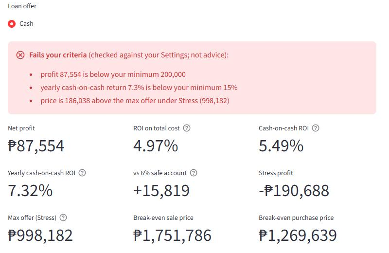

*A real screening: a 42.5 sqm townhouse in Jade Residences, Imus, at
Pag-IBIG's ₱1,184,220 minimum bid (property number left out). With a
bare-shell renovation estimate and paying cash, it would earn ₱87,554, and
the most it could cost to survive a bad case is ₱998,182, below the minimum
bid. Verdict: don't bid, unless the unit turns out to be finished already.*

## What it does for a flipper

| Step | What the tool does |
|---|---|
| **Find** | Imports every house on Pag-IBIG's [Online Public Auction](https://www.pagibigfundservices.com/OnlinePublicAuction/) (a browser snippet you run once a month: about 1,500 houses for Cavite) and screens each one **like for like**: against resale and new homes of a similar size and type in the **same subdivision** first. Shows how many foreclosures you would be competing with when you resell, and hides offers that have closed. |
| **Price** | One-click searches for comps (Facebook Marketplace and groups, the listing sites), drafts of the most similar listings it already has, and a **paste reader** that tells resale, new, pasalo, and foreclosed listings apart and fills in their numbers. Works out a **pasalo's real price** (cash-out + what is still owed, checked against the loan terms). Suggests an ARV from resale comps, with new units as the ceiling and foreclosures as the floor. |
| **Cost** | Renovation items with a contingency, holding costs, one-time costs (eviction, back dues), loan offers or cash, and Philippine costs: 6% capital gains tax on the highest of sale price, zonal value, or fair market value; about 2.5% buying costs; 3% broker. A business tax mode for habitual flippers. |
| **Decide** | A **verdict against your own rules** (minimum profit, minimum yearly return, a walk-away price), net profit and both ROIs, what happens if things go wrong (Conservative and Stress), your **walk-away bid** (max offer under Stress), break-even prices, which estimate matters most, and what-ifs. |
| **Keep track** | A due-diligence checklist per house, every number in one Excel workbook (checked and backed up on every save), and a downloadable Excel report. |

It runs on your own computer; your deals stay in a local Excel workbook.

## How to use it, step by step

The screenshots follow the Jade Residences townhouse from the top. For a
longer walkthrough of finding a listing and its comps, see
[docs/how-to-use.md](docs/how-to-use.md).

### 1. Install and start

Requires Python 3.11+. In the project folder:

```bash
python -m venv .venv
.venv\Scripts\python -m pip install -e ".[web]"
.venv\Scripts\python -m flip.template
.venv\Scripts\python -m flip.web
```

`flip.template` creates your workbook (`data/deals_input.xlsx`) once;
`flip.web` opens the app in your browser at http://localhost:8501. (On
macOS or Linux, use `.venv/bin/python`.) The app has three pages, in the
order of a deal: **Market scan**, **Edit a house**, **Analyze a house**.

### 2. Refresh Pag-IBIG's listings (once a month)

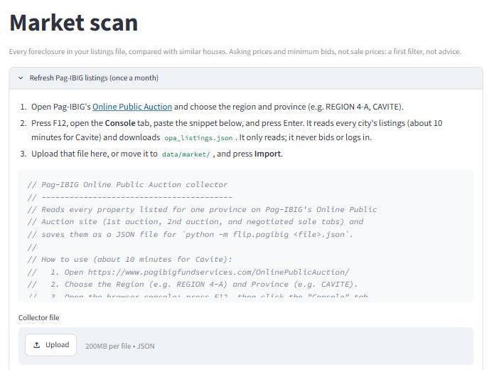

Pag-IBIG has no download button, so the app gives you a small snippet: open
the auction site, choose the region and province, paste the snippet into
the browser's console (F12), and it reads every city's listings and saves
them to a file (about 10 minutes for Cavite). Upload that file and press
**Import**. It only reads the pages; it never logs in or bids. Houses no
longer listed are removed, and each house keeps its offer window.

### 3. Screen the foreclosures

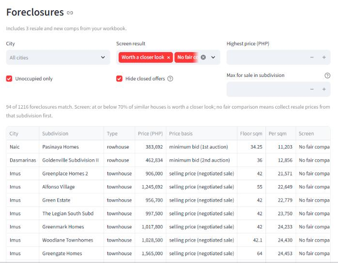

Every foreclosure gets one of three results:

- **Worth a closer look**: at or below 70% of similar houses.
- **Little room**: close to what similar houses cost, even new ones. Skip.
- **No fair comparison**: cheaper than new units elsewhere in the city, but
  there is nothing similar to compare it with yet. Collect resale prices
  from its subdivision first.

Filter by city, unoccupied, open offers, price, and how many are for sale
in the same subdivision (your competition when you resell). Jade showed
*no fair comparison*: the only prices the data had were new units.

### 4. Start a deal

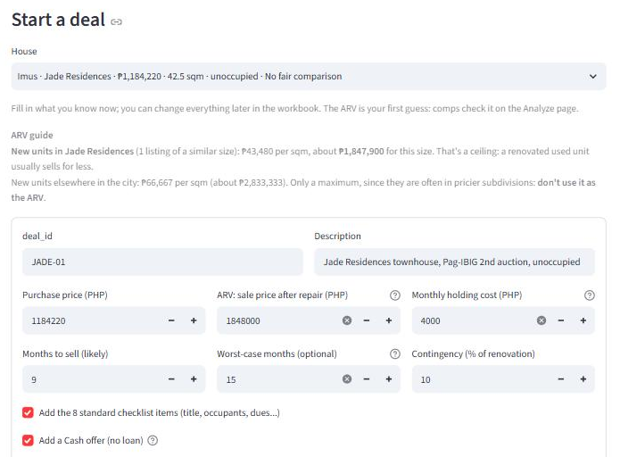

Pick the house; its price, size, and location are filled in. The **ARV
guide** puts the subdivision's own prices first: new Jade units cost about
₱43,480 per sqm (₱1,847,900 for this size), a *ceiling* for a renovated used
unit. The city's new-unit median (₱2,833,333 here) is labeled as only a
maximum, because those units are often in pricier subdivisions. **Add to my
workbook** also adds the standard checklist and a Cash offer, so no loan is
assumed.

### 5. Fill in the house

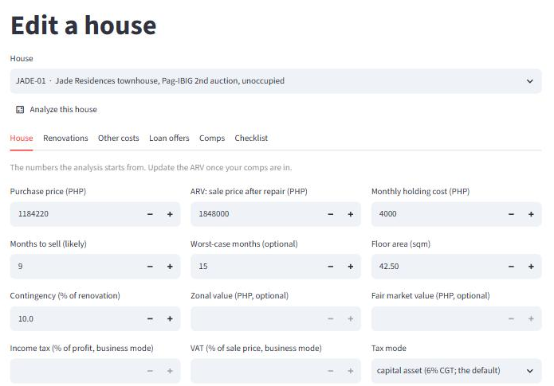

**Edit a house** has one tab per part of the deal: the house's numbers,
renovations, other costs, loan offers, comps, and the checklist. One **Save
changes** button saves only what you changed; the workbook is backed up
first, and nothing is saved while it is open in Excel.

### 6. Find comps

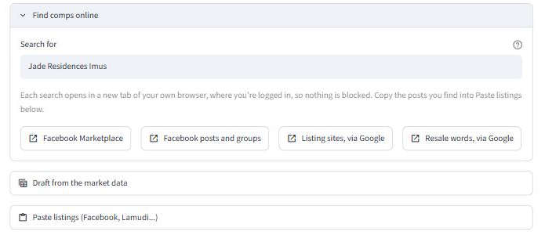

**Find comps online** opens ready-made searches for the subdivision in your
own browser, where you are logged in. **Draft from the market data** lists
the most similar listings the app already has, to tick and add.

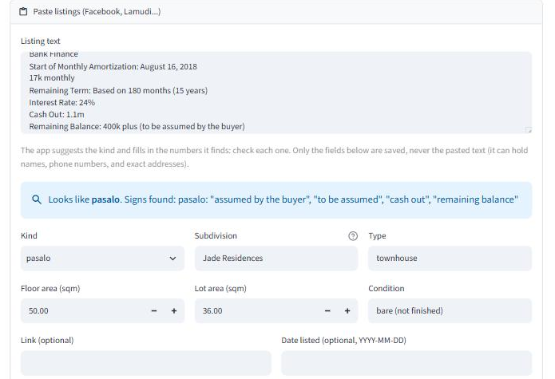

**Paste listings** reads a post's text (or several, separated by a `---`
line). It says what kind of listing it looks like and shows the phrases that
gave it away, then fills in the numbers it found. Only the fields you
confirm are saved, never the pasted text, which can hold names and phone
numbers. It also keeps score of how often its guesses were right.

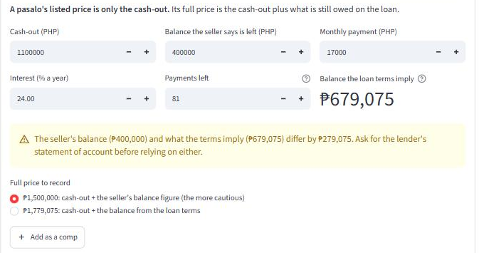

A **pasalo**'s listed price is only the cash-out. This Jade seller asked
₱1.1M cash-out and said ₱400,000 was left on the loan, but 81 more payments
of ₱17,000 at 24% a year come to about ₱679,075. The app shows both full
prices and records the more cautious one.

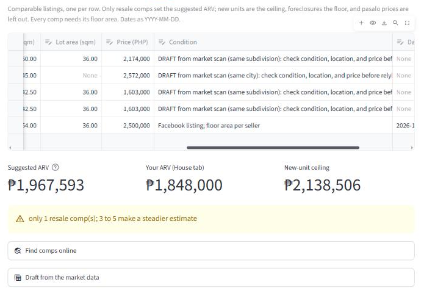

The **suggested ARV** is the median resale price per sqm × the house's floor
area. With one resale comp it warns you: 3 to 5 make a steadier estimate.

### 7. Renovation and payment

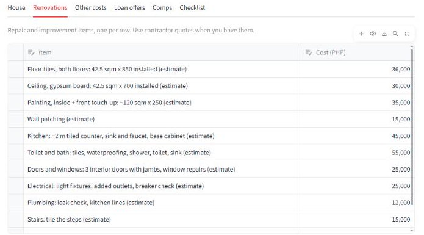

One row per item. Jade's ₱313,000 is a bare-shell estimate built from
Philippine contractor cost guides (marked *estimate*, to replace with
quotes); the app adds a 10% contingency. Add your loan offers next to the
Cash row to compare them.

### 8. Read the verdict

The **Analyze a house** page starts with the verdict and the key figures
(the image at the top of this page):

- **Net profit**, **ROI on total cost** (is it a good deal?), and
  **cash-on-cash ROI** (is it a good use of my money?).
- **Stress profit**: if it sells 10% lower, renovation runs 25% over, and it
  takes your worst-case months.
- **Max offer (Stress)**: your walk-away bid. Jade's is ₱998,182, below the
  ₱1,184,220 minimum bid.
- **Break-even sale and purchase prices.**

### 9. Understand the risk

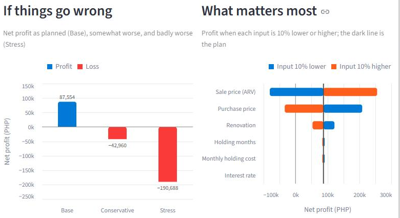

**If things go wrong** shows the profit as planned and in two bad cases:
Jade goes from ₱87,554 to −₱42,960 (Conservative) and −₱190,688 (Stress).
**What matters most** shows which estimate swings the profit most: for Jade,
the sale price. Selling for 10% less turns the profit into a loss, so more
resale comps matter far more than getting the monthly dues exact. A
**What-if** panel tries other numbers without saving them.

### 10. Verify, then bid

Work through the house's checklist (title, occupants, dues, flood risk,
inspection...) and download the Excel report for your records. For Jade,
the numbers pass your rules only if the unit needs about ₱100,000 of work or
less, so the next step was its photos and a viewing, not a bid.

## The math, checked by hand

Every calculation is tested against one hand-calculated deal: a ₱2,800,000
house, renovated for ₱450,000, held 6 months, sold for ₱4,200,000, with a
70% loan at 9%.

| Item | PHP |
|---|---|
| Purchase | 2,800,000 |
| Acquisition (2.5%) | 70,000 |
| Renovation | 450,000 |
| Interest (1,960,000 x 9% x 6/12) | 88,200 |
| Loan fees (1%) | 19,600 |
| Holding (15,000 x 6) | 90,000 |
| Selling (3% broker + 6% CGT) | 378,000 |
| **Total cost** | **3,895,800** |
| **Net profit** | **304,200** |
| Cash invested (own money only) | 1,557,800 |
| ROI on total cost | 7.81% |
| Cash-on-cash ROI | 19.53% |

It looks good until you ask what happens if things slip:

```
                                       Base   Conservative         Stress
ARV                               4,200,000      3,990,000      3,780,000
Renovation                          450,000        495,000        562,500
Holding months                            6              8             10
Net profit                          304,200          8,700       -309,300
ROI on total cost                     7.81%          0.22%         -7.56%
Cash-on-cash ROI                     19.53%          0.52%        -17.29%

Purchase price (asking)           2,800,000
Max offer: break even             3,086,037      2,808,101      2,514,799
Max offer: 200,000 profit         2,897,978      2,621,881      2,330,383
```

A 5% lower sale price, a 10% renovation overrun, and a 2-month delay take
the deal to break-even. To survive the Stress scenario, the offer should
be at most ₱2,514,799, about ₱285,000 below asking.

## Another real screening: an occupied Pag-IBIG house in Imus

A 92 sqm townhouse in Imus, Cavite, at a Pag-IBIG public auction: minimum
bid ₱2,267,730, occupied, title still under consolidation. Replacing each
guess with researched numbers, one at a time (cash purchase):

| Step | Change | Net profit |
|---|---|---|
| Start | All placeholder guesses | +543,577 |
| 1 | ARV from 4 resale comps (median ₱34,750/sqm x 92 sqm = ₱3,197,000) | -5,153 |
| 2 | Holding period 15 months (eviction case + renovation + sale) | -20,153 |
| 3 | Monthly holding cost ₱4,000 | -5,153 |
| 4 | Renovation ₱550,000 + legal costs for eviction ₱90,000 | **-115,153** |

The first ARV guess came from brand-new developer units; real resale comps
were 16% lower, and that single input erased the profit. Both real
screenings teach the same lesson: the sale price estimate matters more than
anything else, and comps of the right kind (resale, same type, nearby) are
what make it believable.

## Honest limits

- **Listing prices are asking prices.** The Philippines has no public record
  of actual sale prices, so comps run a little high.
- **Costs are estimates until they are quotes.** The renovation figures from
  cost guides are ballpark (roughly ±25–30%); inspect and get a contractor's
  quote before bidding.
- **A pasalo's balance is an estimate** from the stated terms; the lender's
  statement of account is the real number.
- **The market data is only as fresh as your last collector run.** Sites
  that block automated reading (Facebook, Lamudi, OnePropertee) are searched
  by you, not scraped.
- **Business tax mode uses rates you enter.** By default a sale is taxed as
  a capital asset (6% CGT). A habitual flipper may be taxed as a business
  instead (income tax and possibly VAT); confirm the rates with an
  accountant. Creditable withholding tax is not modeled.
- **Interest is simple interest on the full loan.** Real loans amortize, and
  prepayment penalties are not modeled.
- **The verdict checks your rules; it doesn't decide for you.** This is a
  learning project, not investment advice.

## For developers

### Setup and tests

```bash
python -m venv .venv
.venv\Scripts\activate          # Windows
source .venv/bin/activate       # macOS / Linux
pip install -e ".[dev]"
python -m pytest
```

On Windows, PowerShell may refuse `activate` ("running scripts is disabled
on this system"). You don't need it: run the project's Python directly,
e.g. `.venv\Scripts\python -m flip.web`, and use `.venv\Scripts\python`
wherever this README says `python`.

### Without the web app

The workbook can be filled in Excel and every report run from the terminal:

```bash
python -m flip.template                                  # create data/deals_input.xlsx
python -m flip.template --upgrade data/deals_input.xlsx  # add new sheets and columns, keep data
python -m flip.tables --input data/deals_input.xlsx      # print each house's report
python -m flip.export --input data/deals_input.xlsx      # write the Excel report
```

Every column header in the workbook has a note explaining it. Replace the
SAMPLE rows with your houses and set **Data type** to REAL on the
Instructions sheet. Typing mistakes are caught before anything is
calculated, with the exact row to fix:

```
Please fix these in your input:
  - Properties row 2 (SAMPLE-01): purchase_price must be a number, got '2.8M'
  - Loan offers row 2 (SAMPLE-01): annual_interest_rate is 9. Did you mean 9%? Type it as 9% or 0.09.
  - Comps row 2 (SAMPLE-1): deal_id SAMPLE-1 is not on the Properties sheet (typo?)
```

### Market data from the terminal

```bash
python -m flip.pagibig data/market/opa_listings.json     # import the collector's file
python -m flip.market data/market/cavite_listings.csv --output output/cavite_market.xlsx --workbook data/deals_input.xlsx
python -m flip.draft TANZA-01                            # draft comps for one house
```

- `flip.pagibig` imports the file saved by
  [docs/pagibig-opa-collector.js](docs/pagibig-opa-collector.js): every
  house with its price, floor and lot area, occupancy, sale type, and offer
  window. Lots, condos, and parking slots are skipped; a property already in
  the file is replaced, and houses no longer listed are removed (only for
  cities in the new file, so a run that stopped early can't wipe out the
  rest). Older PDF lists import the same way.
- `flip.market` writes the market report: medians per city by kind, a
  **Foreclosures** sheet with each house's like-for-like comparison, and the
  **Candidates**. `--workbook` adds the resale and new comps you entered.
  `data/market/cavite_listings.csv` holds about 1,500 public Cavite listings
  (FazWaz plus every Pag-IBIG house), facts and links only.
- `flip.draft` adds the most similar listings to a house's comps, marked
  DRAFT (same subdivision, then barangay, then city; floor area within 25%;
  same type group; up to 5 resale, 2 new, 2 foreclosed).

### Other commands

| Command | What it does |
|---|---|
| `python -m flip.scenarios --min-profit 300000` | Anchor deal scenarios and max offers |
| `python -m flip.batch data/sample_deals.csv` | Many deals from one CSV, one row per house |
| `python -m flip.tables` | Renovation budgets and loan offers from the sample CSV tables |
| `python -m flip.export` | Excel workbook from the sample CSV tables |

### Project layout

```
src/flip/
  analyzer.py      analyze(): cost waterfall, net profit, both ROIs for one deal
  scenarios.py     Base / Conservative / Stress, max offer
  batch.py         analyze() across every row of a pandas DataFrame
  tables.py        properties + renovation items + loan offers -> one row per offer
  decision.py      break-even, what matters most, yearly ROI, safe account, verdict
  comps.py         suggested ARV from comparable sales, by kind, with warnings
  market.py        like-for-like screen of every foreclosure; candidates
  pagibig.py       import Pag-IBIG's listings (Online Public Auction JSON or PDF)
  draft.py         draft comps for a house from the market data
  find_comps.py    one-click comp searches
  listing_text.py  read a pasted listing: kind, numbers, pasalo full price
  paste_log.py     keep score of the listing reader's guesses
  inputs.py        load CSV or Excel input, check it for typing mistakes
  template.py      create the Excel input workbook
  workbook.py      save into the workbook safely: checked, backed up
  editing.py       the Edit page's conversions (rates as %, dates as text)
  export.py        write the formatted Excel report
  app.py           the web app (Streamlit): views/market.py, views/edit.py,
                   views/analyze.py; ui.py has shared pieces; web.py starts it
  charts.py        web app charts, colorblind-safe in light and dark mode
tests/             hand-calculated tests for every module
data/              SAMPLE data (made up, labeled as such) and public market data
docs/
  how-to-use.md        a longer walkthrough, from listing to verdict
  glossary.md          every finance term, explained with the anchor deal
  project-context.md   build order, decisions, and assumptions
```

### Design decisions

- **Tests use hand-calculated numbers, never the code's own output.** Each
  test shows its arithmetic in comments so it can be checked with a
  calculator. A test that copies the code's output would pass even when the
  code is wrong.
- **Both ROIs, always.** ROI on total cost answers "is this a good deal?";
  cash-on-cash ROI answers "is this a good use of my money?". They can
  point in different directions: a bigger loan raises cash-on-cash ROI
  while lowering profit and making losses worse.
- **One calculation, reused everywhere.** Scenarios, batch analysis, loan
  comparisons, max offer, the web app, and the Excel export all call the
  same `analyze()`, so a fix in one place fixes every report.
- **Excel holds values, not formulas.** Python is the tested source of
  truth; rewriting the math as Excel formulas would create a second,
  untested copy.
- **The web app saves only through one guarded path** (`workbook.py`): it
  refuses while Excel has the file open, writes a copy that must pass the
  same input checks as the reports, backs up the original, then replaces
  it. What-if numbers are never saved.
- **Like for like before cheap.** A foreclosure is compared with similar
  houses in its own subdivision first. New units elsewhere in a city can
  only rule a house out, never in: they are often in pricier subdivisions.
- **Median, not average, for comps,** so one unusual listing can't pull the
  ARV estimate up on its own. Only resale comps count; new units and
  foreclosures bound the estimate instead, and pasalo prices are converted
  to a full price or left out.
- **Max offer by binary search over `analyze()`** instead of a separate
  formula, so it stays correct if the cost model changes.
- **Yearly ROI is simple, not compounded** (ROI x 12 / months), matching
  how a savings rate is quoted, so a deal can be compared with a safe
  account.
- **Purchase price is not a scenario variable.** Once you sign, it is the
  one number you decide. The uncertainty is in sale price, renovation, and
  time; the max offer turns that into a price to bid toward.
- **Private data stays private.** Real deals (`data/deals_input.xlsx`), its
  backups, and the reader's score log are gitignored; pasted listing text is
  never stored; sample files carry a `# SAMPLE DATA` line that tests
  enforce.

## Terms

New to the finance terms (ARV, cash-on-cash ROI, zonal value, comps,
pasalo)? See [docs/glossary.md](docs/glossary.md).

## How this was built

A learning and portfolio project, built with
[Claude Code](https://claude.com/claude-code). I set the scope, the cost
waterfall and ROI definitions, the Philippine cost assumptions, and the
hand-calculated anchor deal, reviewed the calculation code, and tested the
tool on real Pag-IBIG listings; Claude Code wrote most of the
implementation and tests.
