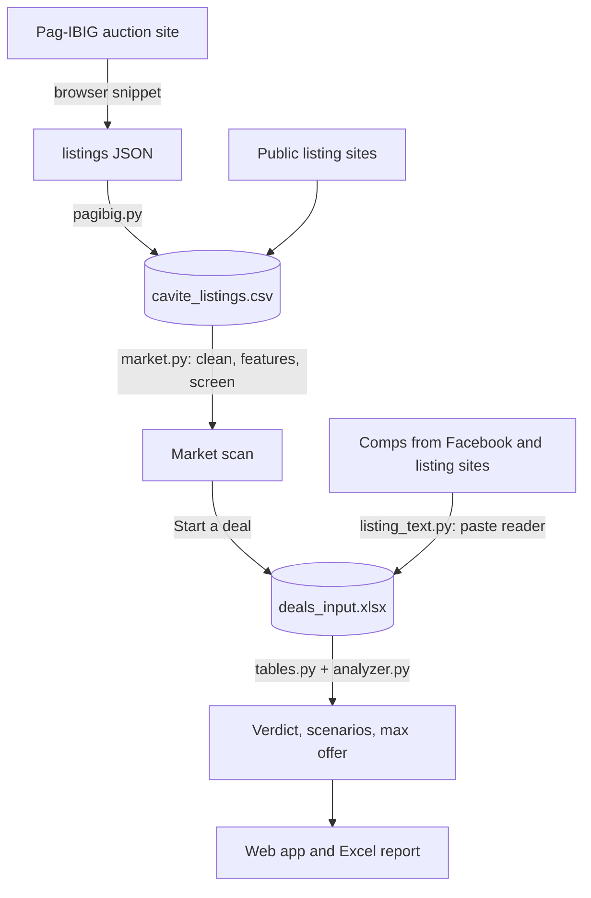
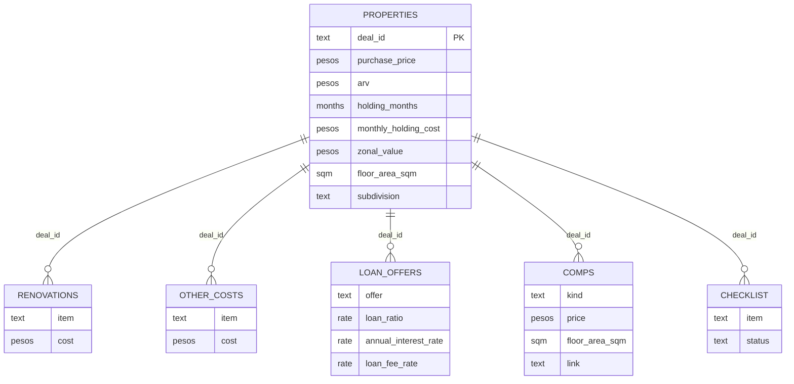

# 🏠 House Flip Deal Analyzer: Pag-IBIG Foreclosures (Philippines)

In this project, I built a data pipeline and a web app that check whether a
foreclosed house in the Philippines is worth flipping: buying it,
renovating it, and selling it at a profit. It collects every house on
Pag-IBIG's online auction, screens each one against similar homes, and
models a deal with Philippine costs and taxes down to a verdict and a
walk-away bid.


## Objective

In the United States, house flipping is an established business, with its
own financing: **hard money lenders**, private lenders who make short-term
loans based on what a house will be worth after repair. In the Philippines,
flipping is still small and informal, yet Pag-IBIG auctions thousands of
foreclosed houses, about 1,500 in Cavite alone.

The question: **can the flipping model work here, with Philippine prices,
costs, and taxes?** To answer it, I:

1. Collected every Pag-IBIG house in Cavite, plus public listings to compare
   them with.
2. Cleaned the listings and built features that make houses comparable.
3. Screened every foreclosure like for like, with transparent rules.
4. Priced single houses with comps, using a listing reader with a human in
   the loop.
5. Modeled each deal: costs, both ROIs, bad-case scenarios, and the most to
   bid.
6. Validated every calculation against hand-calculated numbers.

## Table of Contents

- [Dataset Used](#dataset-used)
- [Technologies](#technologies)
- [Data Pipeline Architecture](#data-pipeline-architecture)
- [Data Modeling](#data-modeling)
- [Step 1: Collect](#step-1-collect)
- [Step 2: Clean and Build Features](#step-2-clean-and-build-features)
- [Step 3: Screen](#step-3-screen)
- [Step 4: Price a House with Comps](#step-4-price-a-house-with-comps)
- [Step 5: Model the Deal](#step-5-model-the-deal)
- [Step 6: Validate](#step-6-validate)
- [Results](#results)
- [Design Decisions](#design-decisions)
- [How to Run It](#how-to-run-it)
- [Limits](#limits)

## Dataset Used

All prices are asking prices (minimum bids for Pag-IBIG); the Philippines
has no public record of actual sale prices.

- **Pag-IBIG [Online Public Auction](https://www.pagibigfundservices.com/OnlinePublicAuction/)**:
  1,482 Cavite houses with price, floor and lot area, occupancy, and offer
  window (collected October 18, 2026).
- **Public listings**: 322 new, resale, and foreclosed listings from FazWaz
  and other listing sites, for comparison (October 16, 2026).
- **Comps**: resale prices collected by hand per house from Facebook
  Marketplace and listing sites. Kept in a private workbook, not in this
  repo.

The market data is in [data/market/cavite_listings.csv](data/market/cavite_listings.csv)
(facts and links only). Every term is explained in the
[glossary](docs/glossary.md).

## Technologies

- **Language:** Python 3.11
- **Data:** pandas, pdfplumber (older Pag-IBIG PDF lists)
- **Collection:** a JavaScript snippet run in the browser
- **Storage:** CSV and an Excel workbook (openpyxl)
- **App:** Streamlit
- **Testing:** pytest (247 tests)

## Data Pipeline Architecture



- **Collect:** [pagibig-opa-collector.js](docs/pagibig-opa-collector.js),
  [pagibig.py](src/flip/pagibig.py)
- **Clean, features, screen:** [market.py](src/flip/market.py)
- **Comps:** [listing_text.py](src/flip/listing_text.py),
  [find_comps.py](src/flip/find_comps.py), [draft.py](src/flip/draft.py),
  [comps.py](src/flip/comps.py)
- **Model:** [analyzer.py](src/flip/analyzer.py),
  [scenarios.py](src/flip/scenarios.py), [decision.py](src/flip/decision.py)
- **Storage:** [workbook.py](src/flip/workbook.py) (checked and backed up
  on every save)
- **App and report:** [app.py](src/flip/app.py) and
  [views/](src/flip/views), [export.py](src/flip/export.py)

## Data Modeling

Each house being analyzed lives in one Excel workbook: one row per house on
**Properties**, and its costs, loan offers, comps, and checklist on their
own sheets, linked by `deal_id`.



A house with three loan offers becomes three rows to analyze, so paying
cash and each loan can be compared side by side.

## Step 1: Collect


Pag-IBIG has no download button, so I wrote a browser snippet that reads
every city's listings page by page and saves them to a file (1,538 Cavite
properties in about 10 minutes). It only reads; it never logs in or bids.
The import skips lots and condos, replaces houses already in the file, and
removes houses no longer listed. Sites that block automated reading, like
Facebook, are searched by hand instead of scraped.

## Step 2: Clean and Build Features

**Cleaning** removes:

- repeated listings (same link, or the same city, kind, price, and size)
- lots, condos, and floor areas under 25 sqm (usually a lot area or a typo)
- prices per sqm outside ₱10,000–150,000 (data errors)

**Features** that make houses comparable:

- price per sqm
- subdivision names matched across sources ("MICARA ESTATES TANZA PHASE 1"
  = "Micara Estates")
- house type groups and a ±25% floor area window
- how many foreclosures are for sale in the same subdivision (the
  competition when reselling)
- each offer's closing date

## Step 3: Screen


Every foreclosure is compared like for like: similar houses in its own
subdivision first, then the city. Each gets one result:

- **Worth a closer look:** at or below 70% of similar houses.
- **Little room:** close to what similar houses cost.
- **No fair comparison:** cheaper than new units elsewhere in the city, but
  nothing similar to compare with yet.

## Step 4: Price a House with Comps


The sale price after renovation (the **ARV**) comes from resale comps. The
app opens ready-made searches for the subdivision, and a rule-based reader
reads pasted listings: it tells resale, new, pasalo, and foreclosed listings
apart, shows the phrases behind its guess, and fills in the numbers. I
confirm each field before it is saved, and every correction is logged, so
the reader's accuracy is measured, not assumed.


A **pasalo** (a house whose loan the buyer takes over) lists only the
cash-out. The app adds what is still owed, checked against the loan terms,
so the comp uses the full price.


The **suggested ARV** is the median resale price per sqm × the house's
floor area.

## Step 5: Model the Deal


For each house, the model works out:

- **Costs:** purchase, about 2.5% buying costs, renovation plus a
  contingency (10% by default), holding costs, loan interest and fees, a 3%
  broker, and 6% capital gains tax on the highest of sale price, zonal
  value, or fair market value.
- **Net profit, ROI on total cost, and cash-on-cash ROI.**
- **Two bad cases:** Conservative (sells 5% lower, renovation 10% over,
  halfway to the worst-case months) and Stress (10% lower, 25% over, the
  worst-case months).
- **What matters most:** which estimate swings the profit most (the tornado
  chart).
- **Max offer:** the highest price that still breaks even under Stress,
  found by binary search over the same model.
- **A verdict against the user's rules:** minimum profit, minimum yearly
  return, and a price within the Stress max offer.

## Step 6: Validate

Every test checks hand-calculated numbers, never the code's own output. The
anchor deal: a ₱2,800,000 house, renovated for ₱450,000, held 6 months, sold
for ₱4,200,000, with a 70% loan at 9%.

| Item | PHP |
|---|---|
| Total cost | 3,895,800 |
| **Net profit** | **304,200** |
| Cash invested (own money only) | 1,557,800 |
| ROI on total cost | 7.81% |
| Cash-on-cash ROI | 19.53% |
| Net profit in Stress | -309,300 |
| Max offer (Stress, break even) | 2,514,799 |

The full breakdown is in the [glossary](docs/glossary.md).

## Results

From the October 2026 Cavite data:

- **No foreclosure passed a fair comparison.** Of 1,216 screened houses, 0
  were worth a closer look, 642 had little room, and 574 had no fair
  comparison. The 14 that had new units in their own subdivision to compare
  with were priced at 77–115% of them (median 95%).
- **Resale prices are the bottleneck.** 574 houses can't be judged because
  resale prices in their subdivisions aren't online.
- **Supply is concentrated.** Tanza (578) and Naic (360) hold most of the
  Pag-IBIG houses; one subdivision had 188 foreclosures for sale at once.
- **The sale price decides the deal.** For an occupied 92 sqm townhouse in
  Imus, replacing guesses with researched numbers turned a ₱543,577 profit
  into a ₱115,153 loss. The biggest change was the ARV: real resale comps
  were 16% below the new-unit prices of the first guess. For the townhouse
  in Jade Residences, Imus (shown above), the profit is ₱87,554, but the
  walk-away bid (₱998,182) is below Pag-IBIG's minimum bid (₱1,184,220).

**Answer so far: rarely, at Pag-IBIG's minimum bids.** The houses that
might work are ones already in good condition, where the renovation is
small.

## Design Decisions

- **Transparent rules, not a black box.** Every screen result can be
  explained in one sentence and checked by hand.
- **Like for like before cheap.** New units elsewhere in a city can only
  rule a house *out*, never in: they are often in pricier subdivisions.
- **Median, not average, for comps,** so one unusual listing can't pull the
  ARV up on its own.
- **Both ROIs, always.** ROI on total cost answers "is this a good deal?";
  cash-on-cash ROI answers "is this a good use of my money?".
- **One calculation, reused everywhere.** Scenarios, max offer, loan
  comparisons, the app, and the Excel report all call the same `analyze()`.
- **Private data stays private.** Real deals are gitignored, and pasted
  listing text (which can hold names and phone numbers) is never stored.

## How to Run It

```bash
python -m venv .venv
.venv\Scripts\python -m pip install -e ".[web]"
.venv\Scripts\python -m flip.template
.venv\Scripts\python -m flip.web
```

The app opens at http://localhost:8501. (On macOS or Linux, use
`.venv/bin/python`.)

- **[User guide](docs/user-guide.md):** the app step by step, with
  screenshots, following one house from the market scan to the verdict.
- **[How to use it by hand](docs/how-to-use.md):** finding a listing and its
  comps, with the Excel workbook and the terminal.
- **Tests:** `pip install -e ".[dev]"`, then `python -m pytest`.

## Limits

- **Asking prices, not sale prices,** so comps run a little high.
- **Costs are estimates until they are quotes.** Inspect and get a
  contractor's quote before bidding.
- **Interest is simple interest on the full loan.** Real loans amortize.
- **Taxes:** a sale is taxed as a capital asset (6% CGT) by default. A
  habitual flipper may be taxed as a business instead; the app has a mode
  for that, with rates confirmed by an accountant.
- **The verdict checks your rules; it doesn't decide for you.** This is a
  learning project, not investment advice.
