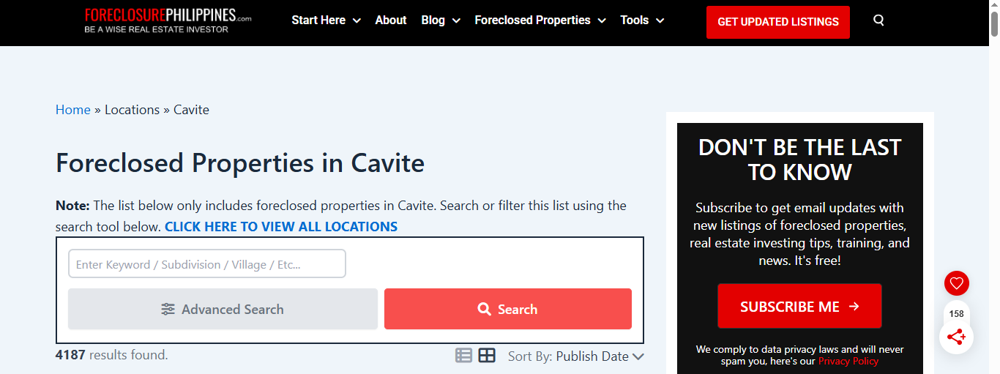
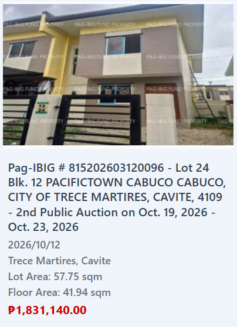
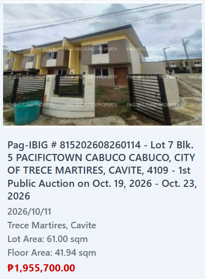

# How to use: from a listing to a decision

This walkthrough follows one house from the listing page to the verdict in
the web app. Allow an hour or two for your first house; later ones are
faster.

You need the project set up once (see [Getting started](../README.md#getting-started))
and Excel to fill in the input workbook.

> The analyzer checks a deal against your own criteria. It is not
> investment advice, and its answers are only as good as the numbers you
> give it.

---

## Step 1: Find a listing

**Where to look**
- Pag-IBIG acquired assets: the [Online Public Auction](https://www.pagibigfundservices.com/OnlinePublicAuction/)
  and sites that list them, such as ForeclosurePhilippines
- Listing sites: Lamudi, FazWaz, Dot Property
- Brokers and local Facebook groups (careful with "pasalo" posts, see Step 2)



**Start with the market scan.** The web app's **Market scan** page (or
`output/cavite_market.xlsx`, built with `python -m flip.market`) compares
every foreclosure with similar houses (same subdivision, size, and type
first) and runs the Step 2 quick screen for you. Each house gets one of
three results:

- **worth a closer look**: at or below 70% of a fair comparison. These are
  also on the **Candidates** sheet.
- **little room**: near what similar houses cost, even new ones. Skip.
- **no fair comparison**: cheaper than new units elsewhere in the city,
  but nothing similar to compare with. Collect a few resale prices from
  its subdivision (Step 2), add them to the listings CSV as `resale`, and
  rebuild. One subdivision's prices cover all its foreclosures.

Prefer unoccupied units, and check **Foreclosures for sale in subdivision**:
when dozens of the same house are for sale from Pag-IBIG, you will resell
against them. When one looks worth pursuing, press **Start a deal** on the
page: it adds the house to your workbook (with the standard checklist), and
you continue with Step 2.

To keep it current, collect Pag-IBIG's listings once a month: the page's
**Refresh Pag-IBIG listings** section has the steps, the browser snippet
(`docs/pagibig-opa-collector.js`), and an Import button. Or in the terminal:

```bash
python -m flip.pagibig data/market/opa_listings.json
python -m flip.market data/market/cavite_listings.csv --output output/cavite_market.xlsx
```

**What makes a good candidate:** a price well below what *renovated* homes
nearby sell for; vacant rather than occupied; a clean or consolidated title.

**Write down:** the link, the price (and whether it is a minimum bid),
floor area, lot area, type (townhouse, single detached...), occupied or
vacant, title status, and any auction dates.



*Example:* a Pag-IBIG foreclosed townhouse in Pacifictown Cabuco, Trece
Martires, Cavite, at the second public auction (Oct 19–23, 2026). It is
an end unit with eaves: 41.94 sqm floor area on a 57.75 sqm lot.

| Fact | Value |
|---|---|
| Minimum bid | ₱1,831,140 |
| Price per sqm of floor area | ₱43,661 (1,831,140 ÷ 41.94) |
| Occupied or vacant | Unoccupied: no eviction needed |
| Title | Under consolidation: not yet in Pag-IBIG's name, so expect waiting |

Why it made the shortlist: it is vacant (unlike an occupied unit that
would need an eviction), and an end unit usually sells for more than an
inner one. The open question is whether ₱43,661 per sqm leaves room for
profit; the comps in Step 2 answer that.

---

## Step 2: Collect 3 to 5 comps

Comps are similar homes nearby that show what your house could sell for
after renovation. Good comps are:
- **resale**: someone selling an existing home outright
- the **same type** and a **similar floor area**
- **renovated or in good condition**
- **nearby**: same subdivision or barangay if possible
- **recent**: listed within the last year

For each comp, write down: subdivision, link, type, **floor area**, lot
area, price, condition, and date listed.

**Start with drafts.** Add the house to the Properties sheet (Step 4) with
its `city`, `barangay`, `subdivision`, and `type`, then run
`python -m flip.draft YOUR-DEAL-ID`. The most similar listings from the
market data land on the Comps sheet marked DRAFT. Check each one, delete
the poor matches, and add the comps you find yourself.

**Where to find resale homes**
- Listing sites (FazWaz, Lamudi, Dot Property, OnePropertee, Carousell).
  Search with words like "renovated", "upgraded", "with improvements",
  "pre-owned", "resale", "owner selling" (FazWaz marks these FSBO).
  Listings that say "pre-selling", "RFO", "reservation fee", "down payment
  terms", or "promo" are developer units: record them as kind `new`.
- Facebook Marketplace, local real estate groups, and the subdivision's
  own homeowners' page.
- Local brokers (ask what renovated units actually *sold* for), "For Sale"
  signs, and the HOA office.

**Spotting renovation:** new tiles, kitchen cabinets, ceilings, or an
extension in the photos. "With improvements" often means an extension;
check that the floor area includes it.

**If you can't find 3 resale comps:** areas full of new developments may
have few resales yet. Enter what you find with the right `kind`; the
new-unit ceiling then becomes the key number.

**Watch out for:**
- **Brand-new developer units** sell for more than any resale. The analyzer
  uses them only as a ceiling.
- **Pasalo** posts show only the cash-out, not the house's price. Ask for
  the total contract price (TCP), or skip them.
- **Foreclosures** show the as-is price before repairs. The analyzer uses
  them only as a floor.



> **Quick screen: stop here if the numbers can't work.**
> Compare the price with what a **brand-new unit** of similar size costs
> nearby. Buying costs (~2.5%), selling costs (~9%), and renovation plus
> holding (often ~15% of the sale price) leave room for a profit only if
> the price is **at most about 70% of the new-unit price**, and that is the
> best case, where your renovated house sells for as much as a new one.
> Above that, move on to another listing.

*Example:* the Trece Martires townhouse failed this screen.

| Comp | Kind | Floor area | Price | Per sqm |
|---|---|---|---|---|
| Pacific Town Cabuco (same subdivision) | new | 42.30 sqm | ₱1,900,000 | ₱44,917 |
| Camella Trece, "as is, where is" | foreclosed | 40 sqm | ₱1,004,000 | ₱25,100 |
| Camella Trece, bank foreclosed | foreclosed | 39 sqm | ₱1,056,000 | ₱27,077 |

No renovated resales could be found; the area sells mostly brand-new
developer units. For the house's 41.94 sqm, the new-unit **ceiling** is
₱1,883,830 and the foreclosed **floor** is ₱1,094,150. The minimum bid of
₱1,831,140 is **97% of the brand-new price** in the same subdivision.

Even selling at that ceiling, with about ₱252,000 renovation, a 10%
contingency, and 10 months held, the deal loses ₱469,833. It would need to
sell for ₱2,400,130 to break even, 27% more than a brand-new unit. Even a
30% cash discount, if Pag-IBIG applied one to this auction, would leave
only ₱93,242 at the most optimistic sale price.

**Decision: ruled out at Step 2**, before filling in the workbook.

---

## Step 3: Open the input workbook

First time: create it.

```bash
python -m flip.template
```

Already have one: bring it up to date (your data is kept).

```bash
python -m flip.template --upgrade data/deals_input.xlsx
```

Open `data/deals_input.xlsx` in Excel. The **Instructions** sheet explains
every column, and hovering over a column header shows a note too. Delete
the `SAMPLE-01` example rows when you enter real houses, and set **Data
type** to `REAL`.


---

## Step 4: Fill in Properties

One row per house. Make up a short `deal_id` (e.g. `BACOOR-01`) and use it
on every sheet.

| Column | Where it comes from |
|---|---|
| purchase_price | The listing price, or the bid you plan to make |
| arv | Your expected sale price after renovation. Start with a guess; Step 9 shows what your comps suggest |
| holding_months | Months from buying to selling: payment and title transfer, eviction if occupied, renovation, finding a buyer |
| holding_months_worst | The worst case, e.g. if an eviction is contested |
| monthly_holding_cost | Association dues, utilities, property tax / 12, security |
| floor_area_sqm | From the listing |
| contingency_rate | Buffer for renovation surprises, e.g. 10% |
| zonal_value | Optional: BIR zonal value per sqm x lot area |
| source_url | The listing link |


---

## Step 5: Renovations, Other costs, and Loan offers

- **Renovations:** one row per item (roof, kitchen, paint...). Use
  contractor quotes when you have them. As a rough guide, cosmetic work
  runs about ₱3,000-8,000 per sqm.
- **Other costs:** costs that aren't renovation, such as eviction and legal
  fees, unpaid association dues or property tax, and title transfer.
- **Loan offers:** one row per way of paying. Add a `Cash` row with `0%`
  in every rate column to compare. Type rates with the `%` sign.


---

## Step 6: Fill in the Comps sheet

One row per comp from Step 2. Two columns matter most:
- **floor_area_sqm**: the suggested ARV is the comps' median price per sqm
  times your house's floor area
- **kind**: `resale`, `new`, `foreclosed`, or `pasalo`


---

## Step 7: Checklist and Settings

- **Checklist:** copy the 8 standard items for your house and mark each
  one `open`, `done`, or `issue` (with a note) as you check it.
- **Settings:** your criteria for a deal worth doing. The defaults are a 6%
  safe account, ₱200,000 minimum profit, 15% minimum yearly cash-on-cash
  return, and a price at or below the max offer under Stress.

Save the workbook.


---

## Step 8: Start the web app

```bash
python -m flip.web
```

It opens in your browser at http://localhost:8501. Pick your house at the
top. If anything in the workbook is mistyped, the app lists each problem
with the sheet and row to fix.


---

## Step 9: Read the results

**The verdict** says whether the deal meets your Settings, and if not, why.

**The key numbers**

| Number | The question it answers |
|---|---|
| Net profit | What do I make if everything goes to plan? |
| ROI on total cost | Is this a good deal? (profit / everything spent) |
| Cash-on-cash ROI | Is this a good use of my own money? (profit / my cash) |
| Yearly cash-on-cash ROI | The same, per year, so short and long flips compare fairly |
| vs safe account | How much more (or less) than leaving my cash in a safe account? |
| Stress profit | What if it sells 10% lower, renovation runs 25% over, and it takes longer? |
| Max offer (Stress) | The most I can pay and still not lose money if things go badly: **my walk-away price** |
| Break-even sale price | The lowest sale price before I start losing money |
| Break-even purchase price | The most I can pay before I lose money, even if everything goes to plan |

**The charts**
- **If things go wrong:** profit as planned, somewhat worse, and much worse
- **What matters most:** which estimate moves your profit the most. Get
  that one right before buying
- **Where the money goes:** every cost on top of the price

**Is the sale price realistic?** compares your ARV with what your comps
suggest, and warns about weak comps.


---

## Step 10: Try a what-if

Open **What-if** and change a number. The page updates right away, and
your workbook is never changed. Good first questions:
- *What if I bid exactly the max offer?* Set the purchase price to it.
- *What if it sells for less?* Lower the ARV to the low end of your comps.
- *What if the eviction drags on?* Raise the holding months.


---

## Step 11: Download the Excel report

The sidebar's **Download the Excel report** button saves every house's
analysis, including any what-if numbers, with sheets for the summary,
cost waterfall, scenarios, what matters most, ARV check, inputs, and
checklist.


---

## Then

Replace estimates with real numbers as you get them (contractor quotes,
bank offers, confirmed zonal value), and run it again. The decision is
yours; the analyzer makes sure it's an informed one.
